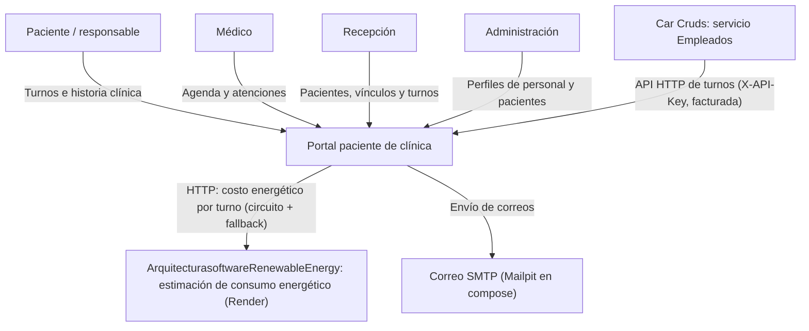
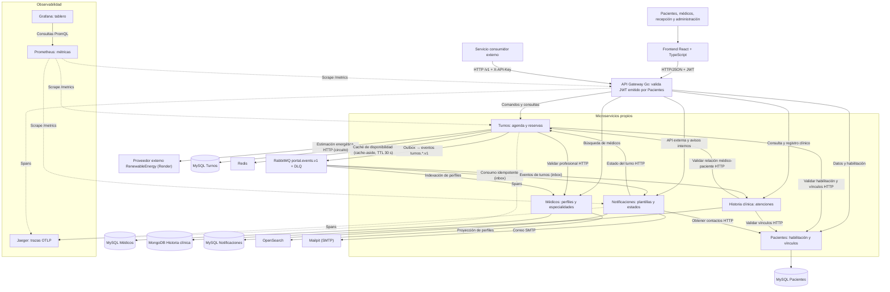

# Diagramas actualizados
contexto.mmd y contenedores.mmd contienen Mermaid procesable. Representan el sistema implementado para la presentación final.
Incluyen frontend, propósito y transporte de las conexiones, propiedad de la agenda en Turnos y conexión explícita de Notificaciones a su base.
La capacidad externa consumida es la estimación de consumo de `ArquitecturasoftwareRenewableEnergy` (ADR-009). La identidad la emite el servicio Pacientes (JWT, ADR-014).
Los archivos diagrams.net originales de Drive no fueron editados. Para conservar ese formato, trasladar estos cambios a los originales antes de presentar. Mermaid puede previsualizarse en GitHub.

## Contexto

## Contenedores

Actualizado para la presentación final: los seis componentes (gateway, Turnos, Pacientes, Médicos, Historia clínica y Notificaciones) están operativos, con outbox y DLQ, caché Redis, OpenSearch, proveedor externo y la pila de observabilidad.

